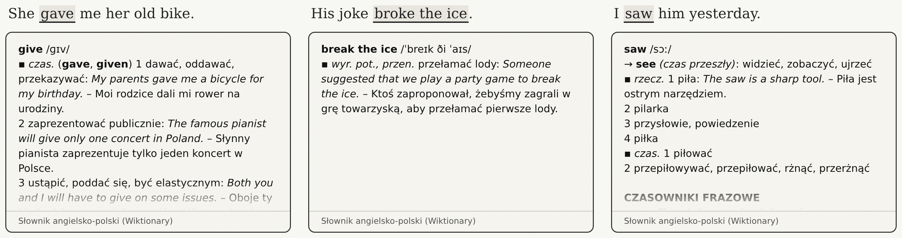
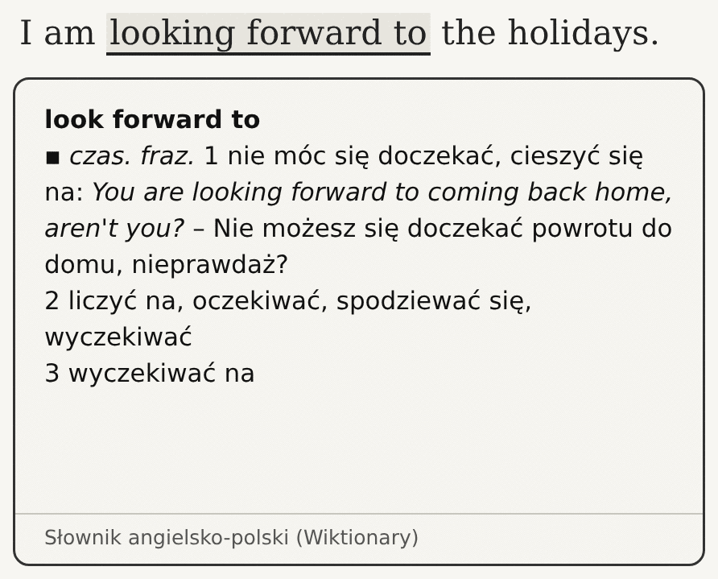
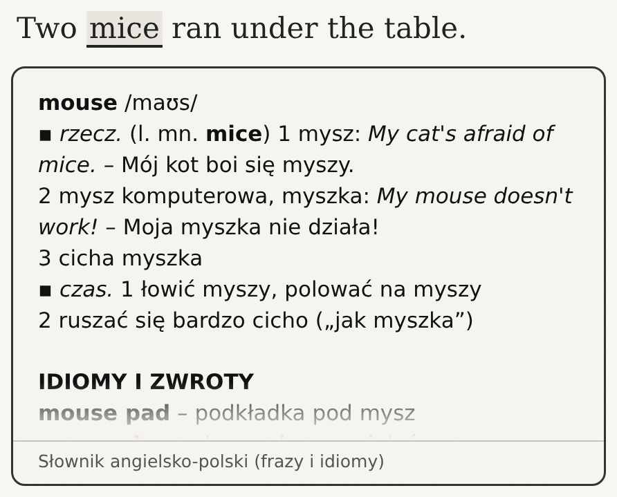
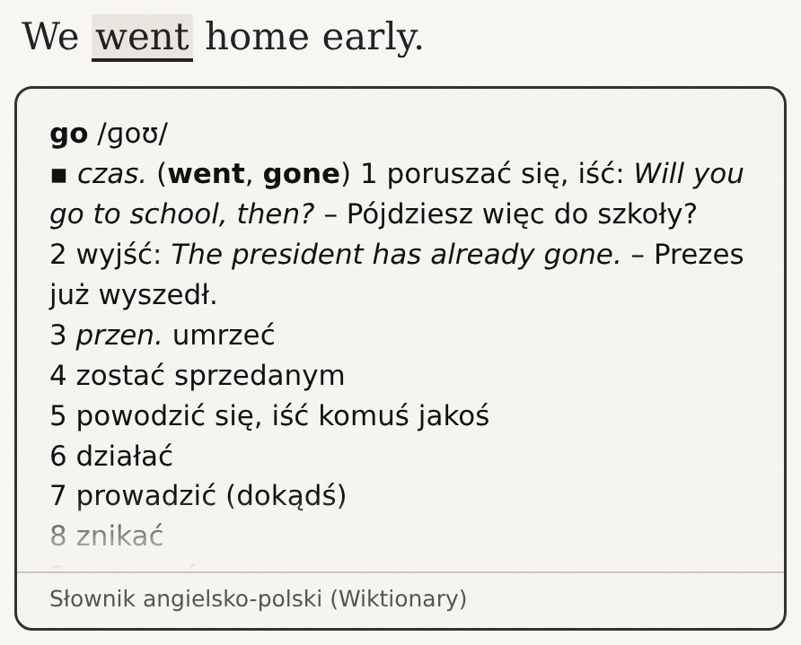
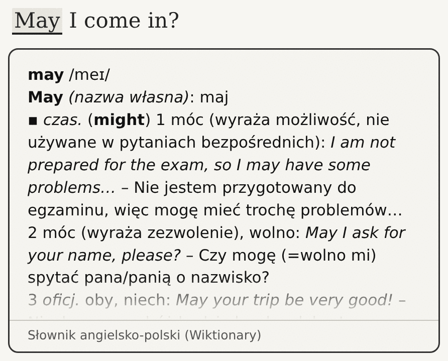

# kindle-en-pl-dictionary

**Learn the phrases, not just the words.**

You read books in English and want to keep learning as you read. Not only new
words, but also phrasal verbs and idioms like *put up with* or *break the ice*.
Kindle dictionaries rarely find those, so this English–Polish dictionary gives
each of them an entry of its own.

## Features

- **108,000 entries** with Polish meanings and example sentences from the
  Polish and English Wiktionary
- **Phrasal verbs and idioms** as entries of their own, inflected forms
  included, so selecting *gave up* opens *give up* and *broke the ice* opens
  *break the ice*
- **Inflected forms** like *went*, *children* or *better* open *go*, *child*
  and *good*
- **Clear entries** modelled on the Oxford Dictionary of English, with the
  meanings and examples first and the most common phrasal verbs and idioms of
  the word after them
- **Words that are also forms of other words** show both meanings, so *saw*
  gives *piła* as well as *see*

## More examples

  
  
  
  

The previews are rendered from the dictionary itself. On a Kindle the font and
line breaks differ slightly, and long entries continue on the next page of the
popup.

## Installation

1. Download `kindle-en-pl-dictionary.mobi` from
   [Releases](../../releases/latest).
2. Connect the Kindle to your computer with a USB cable and copy the file into
   `documents/dictionaries/`. Don't use Send to Kindle, because it converts the
   file and the dictionary stops working.
3. On the Kindle, open **Settings**, then **Language & Dictionaries** and
   **Dictionaries**, and choose **Słownik angielsko-polski (Wiktionary)** for
   **English**.
4. In an English book, long-press a word, or drag-select a phrasal verb or an
   idiom.

Kindles from 2024 on connect over MTP instead of as a USB drive. On Windows and
Linux they show up as a device in the file manager, and on macOS you need an
MTP app such as [OpenMTP](https://openmtp.ganeshrvel.com/).

## Check it on your Kindle

Each release also contains `dictionary-test.azw3`, a short English test book.
Copy it into `documents/`, open it and look up the **bold** words and the
underlined phrases. Every line says which entry should open.

## Tested devices

| Device | Firmware | Single words | Phrasal verbs and idioms |
|---|---|:---:|:---:|
| Kindle Paperwhite (12th generation, 2024) | 5.20.1 | ✅ | ✅ |

Tried it on another Kindle? Let us know in an [issue](../../issues).

## Contributing

Found a wrong translation or a missing word? [CONTRIBUTING.md](CONTRIBUTING.md)
explains how corrections work and how to build the dictionary from source.

## License

The dictionary content is licensed under [CC BY-SA 4.0](LICENSE-DATA) and comes
from Wiktionary (see [ATTRIBUTION.md](ATTRIBUTION.md)). The code is licensed
under the [MIT License](LICENSE).
